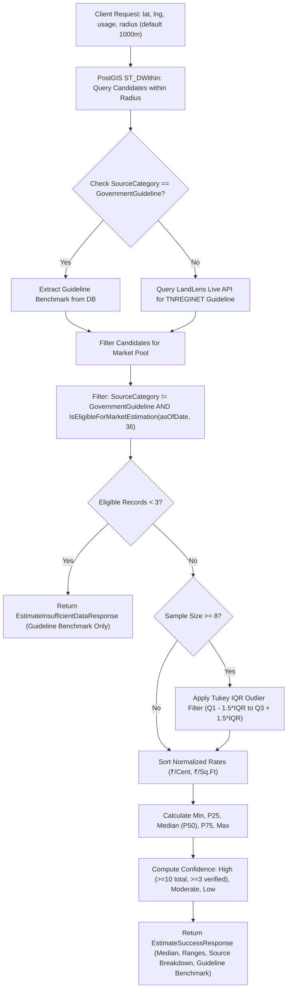
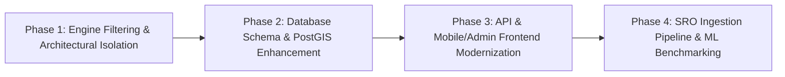

# GREENART PROPERTIES — LAND PRICE PREDICTION ENGINE AUDIT & MODERNIZATION PLAN
**Document Reference:** `GREENART-ENG-AUDIT-2026-V1`  
**Author:** Senior .NET Backend Architect, Geospatial Data Engineer & Valuation Systems Lead  
**Scope:** Tamil Nadu Land Market Rate Analyst & Automated Valuation Model (AVM)  
**Status:** Architecture Audit & Strategic Roadmap (Completed)  

---

## Executive Summary

Greenart Properties operates a specialized Land Market Rate Analyst platform built on **Clean Architecture (.NET 8 Minimal APIs)**, **PostgreSQL 16 with PostGIS spatial extensions**, a **React/Tailwind Admin Web Dashboard**, and an **Expo React Native Mobile Application**.

While the core geospatial foundation (SRID 4326 PostGIS geography points, GIST spatial indices, and distance functions) is structurally sound, this audit reveals **critical data eligibility and statistical leakage risks in the current estimation pipeline**:
1. **Source Category Contamination:** The current `EstimationEngine` aggregates unverified broker listings (`AdvertisedAskingPrice`) and manual client notes (`ClientResearch`) into the primary market estimation pool.
2. **Statewide Data Sparsity:** The production database currently holds only **13 pilot records across 3 Coimbatore localities**, representing only **6 verified completed transactions statewide**. Thirty-seven out of thirty-eight Tamil Nadu districts have zero records.
3. **Premature Machine Learning Deployment:** Deploying Random Forest, Gradient Boosting, or Deep Learning models against a dataset of 6 to 13 records is mathematically unsound and would result in severe overfitting, misleading variance, and catastrophic legal/financial liability.
4. **Missing Total Valuation & Area Calibration:** Current API requests accept only coordinates and land classification, omitting parcel extent, non-linear plot-size adjustments, and temporal inflation indexation.

This document establishes the architectural, mathematical, and data-engineering roadmap to transform Greenart into a **trustworthy, evidence-based valuation platform** for Tamil Nadu.

---

## 1. Existing Architecture Analysis

The existing codebase adheres strictly to enterprise Clean Architecture boundaries:

```
greenartapp/
├── backend/
│   ├── Greenart.Domain/          # Core Domain Entities, Value Objects, Domain Enums
│   ├── Greenart.Application/     # Use Cases, DTOs, EstimationEngine, Importers, Interfaces
│   ├── Greenart.Infrastructure/  # EF Core, PostGIS, Repositories, Providers, Auth, LandLens
│   └── Greenart.Api/             # Minimal APIs, Program.cs, Swagger, Auth Handlers
├── apps/
│   ├── admin-web/                # React 18, Vite, TypeScript, Tailwind, Leaflet/Google Maps
│   └── mobile/                   # React Native, Expo SDK 51, WebViews, Google Maps SDK
```

### 1.1 Domain Layer (`Greenart.Domain`)
* **`LandPriceRecord`:** Central entity capturing parcel observations. Holds `GeoCoordinate` (lat/lng struct), `LandArea` (extent + unit), `OriginalPrice`, `NormalizedRatePerCent`, `NormalizedRatePerSqFt`, `SourceCategory`, `VerificationStatus`, and `IsSynthetic`.
* **`SourceCategory` Enum:** Classifies data into `GovernmentGuideline (1)`, `VerifiedTransaction (2)`, `AdvertisedAskingPrice (3)`, `ClientResearch (4)`, and `SyntheticFixture (5)`.
* **`VerificationStatus` Enum:** `Unverified (0)`, `PendingReview (1)`, `Verified (2)`, `Rejected (3)`, `Archived (4)`.
* **`HistoricalEstimate` & `HistoricalEstimateObservation`:** Provides an append-only evidentiary audit log linking computed median rates to empirical supporting records.
* **`SourceDocument`:** Stores evidentiary deed scans, surveyor reports, and TNREGINET extracts with cryptographic SHA-256 hashes to guarantee provenance.

### 1.2 Infrastructure Layer (`Greenart.Infrastructure`)
* **`LandPriceDbContext`:** Maps `Location` as a PostGIS `geography(Point, 4326)` with a Generalized Search Tree (`GIST`) index (`idx_land_price_records_location`). Auto-synchronizes spatial `Point` values on save.
* **`EfLandPriceRepository`:** Executes spatial radius queries via `EF.Functions.IsWithinDistance(Location, targetPoint, radiusMeters, true)`. Fallback mechanisms delegate gracefully to `CoimbatorePilotRepository`.
* **`LandLensClient`:** Integrates with the LandLens ONE API to resolve revenue village boundaries, sub-registrar office (SRO) jurisdictions, and live TNREGINET statutory guideline benchmarks.

### 1.3 Application & API Layer (`Greenart.Application` & `Greenart.Api`)
* **`EstimationEngine`:** Implements statistical aggregation (Median, Percentile 25/75, Min, Max, and Tukey IQR outlier removal).
* **`MlReadinessService`:** Audits coverage across all 38 Tamil Nadu districts against an enterprise threshold of 500 verified transactions per district.
* **Minimal API Endpoints:**
  * `POST /api/v1/estimates/calculate`: Primary calculation endpoint.
  * `GET /api/v1/land-records/nearby`: Spatial discovery within radius.
  * `GET /api/v1/coverage/summary`: Statewide distribution metrics.
  * `GET /api/v1/ml/readiness`: Machine learning audit and data-leakage barrier reports.

---

## 2. Current Valuation Calculation Flow

The current flow within `EstimationEngine.cs` operates as follows:



---

## 3. Data Quality & Methodological Problems (Audit Findings)

A line-by-line inspection of `EstimationEngine.cs`, `LandPriceRecord.cs`, and `LandPriceDataSeeder.cs` reveals six major structural vulnerabilities:

### 3.1 Problem 1: Primary Market Pool Contamination
* **Code Location:** `EstimationEngine.cs` (lines 118–121):
  ```csharp
  var eligibleMarketRecords = candidates
      .Where(r => r.SourceCategory != SourceCategory.GovernmentGuideline)
      .Where(r => r.IsEligibleForMarketEstimation(asOfDate, MaxRecordAgeMonths))
      .ToList();
  ```
* **Vulnerability:** The engine filters out `GovernmentGuideline`, but **pools `AdvertisedAskingPrice`, `ClientResearch`, and `VerifiedTransaction` into the same calculation**.
* **Impact:** Asking prices in Tamil Nadu typically carry an inflated negotiation markup of 15% to 35% above true registered deed values. Blending asking prices with verified deeds skews the median upwards and violates professional valuation standards (RICS / IVSC).

### 3.2 Problem 2: Unverified and Synthetic Record Leakage
* **Code Location:** `LandPriceRecord.cs` (lines 105–114):
  ```csharp
  public bool IsEligibleForMarketEstimation(DateTime asOfDate, int maxAgeMonths = 36)
  {
      if (VerificationStatus == VerificationStatus.Rejected || VerificationStatus == VerificationStatus.Archived)
          return false;
      ...
  }
  ```
* **Vulnerability:** `VerificationStatus.Unverified` and `VerificationStatus.PendingReview` evaluate to `true`! Furthermore, `IsSynthetic` is never checked.
* **Impact:** Unverified entries and potential synthetic fixtures can directly influence public-facing valuation estimates.

### 3.3 Problem 3: Statewide Sample Size Deficit (6 Verified Deeds)
* **Empirical Reality:** The entire database contains only 13 seed records:
  * **Kannampalayam:** 5 records (2 verified deeds, 1 asking price, 1 client research, 1 guideline).
  * **Sulur:** 4 records (2 verified deeds, 1 asking price, 1 guideline).
  * **Saravanampatti:** 4 records (2 verified deeds, 1 asking price, 1 guideline).
* **Vulnerability:** In every single pilot hub, **there are only 2 verified transactions**.
* **Impact:** The current engine only succeeds in Kannampalayam because it pulls in the unverified asking price and client research note to meet the `MinimumRecordThreshold = 3`. Under strict verified-only rules, **every location in Tamil Nadu currently triggers `InsufficientData`**.

### 3.4 Problem 4: Absence of Parcel Extent & Size Calibration
* **Vulnerability:** Real estate valuation follows strong non-linear scale curves: a 2-cent (871 sq.ft) residential house plot commands a significantly higher rate per square foot than a 5-acre (500 cents) unplotted layout.
* **Impact:** Current PostGIS queries do not calibrate for parcel extent; a 10-acre industrial plot and a 1,200 sq.ft residential plot within 1,000 meters are aggregated identically.

### 3.5 Problem 5: Omission of Evidence-Based Temporal Adjustments
* **Vulnerability:** Observations up to 36 months old are treated with identical weight ($w_i = 1.0$) as a transaction registered last week.
* **Impact:** In rapidly developing corridors (e.g., Saravanampatti IT Corridor or Sulur Airport Hub), a sale from 2023 significantly understates 2026 market realities without transparent time adjustment.

### 3.6 Problem 6: Fragile Outlier Protection on Small Datasets
* **Vulnerability:** Tukey IQR filtering is gated behind `centRates.Count >= 8`. For sample sizes $N \in [3, 7]$, zero outlier filtering is applied.
* **Impact:** An anomalous asking price or an intra-family distress sale heavily skews the minimum, maximum, and percentile ranges.

---

## 4. Database Changes Required

To support clean architectural separation, evidentiary traceability, and reliable calculations, the following database updates are required:

### 4.1 Schema Refinements to `land_price_records`
```sql
-- Migration: 20261103_RefineLandPriceEvidenceSchema.sql

-- 1. Ensure transaction nature is explicitly enumerated
ALTER TABLE land_price_records 
ADD COLUMN IF NOT EXISTS transaction_nature character varying(50) NOT NULL DEFAULT 'ConveyanceSaleDeed';

-- 2. Explicit SRO Registration Identification
ALTER TABLE land_price_records 
ADD COLUMN IF NOT EXISTS sro_office character varying(100) NULL,
ADD COLUMN IF NOT EXISTS deed_number character varying(50) NULL,
ADD COLUMN IF NOT EXISTS registration_year integer NULL,
ADD COLUMN IF NOT EXISTS book_number integer NULL DEFAULT 1;

-- 3. Completed Sale Strictness Flag
ALTER TABLE land_price_records 
ADD COLUMN IF NOT EXISTS is_completed_sale boolean NOT NULL DEFAULT false;

-- 4. Parcel Physical Characteristics
ALTER TABLE land_price_records 
ADD COLUMN IF NOT EXISTS road_width_feet numeric(6,2) NULL,
ADD COLUMN IF NOT EXISTS is_corner_plot boolean NOT NULL DEFAULT false,
ADD COLUMN IF NOT EXISTS approval_authority character varying(50) NULL; -- DTCP, CMDA, Panchayat

-- 5. Time-Adjustment Audit Trail
ALTER TABLE land_price_records 
ADD COLUMN IF NOT EXISTS annual_time_adjustment_factor numeric(5,4) NULL DEFAULT 1.0000;

-- 6. Indices for strict verified query execution
CREATE INDEX IF NOT EXISTS idx_land_price_records_strict_eligibility 
ON land_price_records (land_usage, verification_status, source_category, is_synthetic, observation_date)
WHERE verification_status = 'Verified' AND is_synthetic = false;
```

### 4.2 Data Category Separation Model
To prevent contamination, data must be partitioned into five isolated logical categories:

| Category | Table / Entity | Permitted in Primary Market Estimate? | Purpose |
| :--- | :--- | :---: | :--- |
| **1. Registered Completed Sales** | `LandPriceRecord` (`SourceCategory.VerifiedTransaction`, `VerificationStatus.Verified`, `IsCompletedSale=true`) | **YES (Exclusive Basis)** | Ground-truth market rate derivation (Median, P25, P75). |
| **2. Statutory Guideline Values** | `LandPriceRecord` (`SourceCategory.GovernmentGuideline`) or LandLens API | **NO (Benchmark Only)** | Statutory floor for stamp duty and legal registration compliance. |
| **3. Advertised Asking Prices** | `MarketplaceListing` / `LandPriceRecord` (`SourceCategory.AdvertisedAskingPrice`) | **NO (Separate Benchmark)** | Market sentiment & seller expectations; displayed with asking haircut. |
| **4. Third-Party Appraisals** | `SourceDocument` (`SourceDocumentType.SurveyorValuationReport`) | **NO (Supporting Audit)** | Independent surveyor/bank valuation reports for arbitration. |
| **5. Client Research & Drafts** | `LandPriceRecord` (`SourceCategory.ClientResearch`, `VerificationStatus.Unverified`) | **NO (Staging Area)** | Internal data queue awaiting SRO/deed verification. |

---

## 5. Recommended Prediction Methodology

Instead of blending disparate data or prematurely applying machine learning, Greenart must adopt a **Three-Tier Evidentiary Valuation Model**:

### 5.1 Tier 1: Primary Market Estimate (Verified Sales Only)
* **Data Gate:** Only records meeting all criteria qualify:
  $$\text{Record} \in \{ \text{VerifiedTransaction} \} \land \text{Status} = \text{Verified} \land \neg\text{Synthetic} \land \text{Age} \le 36\text{ months}$$
* **Geospatial Distance Weighting:** Spatial kernel within 1,000 meters:
  $$w_{\text{dist}}(d_i) = \frac{1}{(1 + d_i / 250)^2}$$
* **Temporal Weighting (Time Decay):** Transactions lose relevance over time:
  $$w_{\text{time}}(\Delta t_i) = \exp(-\lambda \cdot \Delta t_i) \quad \text{where } \lambda = \frac{\ln(2)}{18 \text{ months}}$$
* **Area-Band Filtering:** If the subject property is $A_{\text{target}}$, comparables are filtered into consistent extent tiers:
  * *Micro/Plot:* $\le 5$ Cents (up to 2,178 sq.ft)
  * *Medium Residential:* $5.1$ to $25$ Cents
  * *Large/Commercial/Layout:* $> 25$ Cents
* **Robust Small-Sample Statistics ($N \in [3, 7]$):**
  Instead of standard deviation, use **Median Absolute Deviation (MAD)**:
  $$\text{MAD} = \text{median}(|x_i - \text{median}(X)|)$$
  Outliers are rejected if $|x_i - \text{median}| > 3.0 \times 1.4826 \times \text{MAD}$.
* **Central Estimate:** The weighted median of time-adjusted comparable rates.

### 5.2 Tier 2: Asking Price Reality Check (Market Sentiment)
* Evaluates active broker listings and portal records within radius.
* Applies a documented **Tamil Nadu Market Haircut (default 12% to 18%)** representing average negotiation discount from listing price to deed registration.
* Displayed side-by-side as: *"Market Asking Benchmark: ₹X/sq.ft (Subject to typical 15% negotiation margin)"*.

### 5.3 Tier 3: Statutory Government Guideline Benchmark
* Pulled from TNREGINET / LandLens ONE API based on the resolved revenue village and survey number.
* Displayed explicitly as: *"Government Guideline Value: ₹Y/sq.ft. Statutory reference for registration and stamp duty. Not an open-market price."*

### 5.4 Confidence Classification Matrix
Confidence must never be based solely on raw record count. It must reflect **data density, recency, spatial proximity, and price variance**:

$$\text{Confidence Score} = S_{\text{count}} + S_{\text{recency}} + S_{\text{proximity}} + S_{\text{dispersion}}$$

| Metric | High Confidence (Score $\ge 85$) | Moderate Confidence (Score 60–84) | Low Confidence (Score 40–59) | Insufficient Data ($< 40$) |
| :--- | :--- | :--- | :--- | :--- |
| **Verified Deeds ($N$)** | $\ge 5$ verified sales | $3$ or $4$ verified sales | $3$ sales (high dispersion) | $< 3$ verified sales |
| **Radius** | Within $500$ meters | Within $1,000$ meters | Within $1,500$ meters | $> 1,500$ meters |
| **Max Age** | $\le 12$ months | $\le 24$ months | $\le 36$ months | $> 36$ months |
| **Dispersion (CV)** | $\text{CV} \le 15\%$ | $15\% < \text{CV} \le 25\%$ | $\text{CV} > 25\%$ | High variance / No data |

---

## 6. Machine Learning Readiness Assessment

### 6.1 State of Dataset
* **Total Verified Completed Deeds Statewide:** **6 records**.
* **Districts with $\ge 500$ Deeds:** **0 out of 38 districts**.
* **Spatial Distribution:** Concentrated exclusively in 3 pilot pockets in Coimbatore.

### 6.2 Evaluation of ML Algorithms (Random Forest, Gradient Boosting, XGBoost)
* **Mathematical Assessment:** Supervised machine learning algorithms for spatial tabular regression require a minimum of 50 to 100 observations *per feature* to generalize without catastrophic variance. With standard geospatial and property features (coordinates, land usage, area, road width, distance to arterial road, time epoch), the feature space requires $D \ge 10$.
* **Risk Analysis:**
  * Training a Random Forest or XGBoost regressor on 6 to 13 records results in **100% memorization on the training set ($R^2 \approx 1.0$) and massive out-of-sample error ($\text{RMSE} \to \infty$)**.
  * The model would output arbitrary hallucinated valuations for surrounding localities (e.g., Pollachi, Mettupalayam, Madurai, or Chennai).
* **Verdict:** **DEPLOYMENT GATED. DO NOT TRAIN OR DEPLOY MACHINE LEARNING MODELS AT THIS STAGE.**

### 6.3 Minimum Data Requirements for Future ML Training
Before any ML model (Random Forest or LightGBM) is trained for a target district:
1. **Sample Size:** Minimum **500 verified registered conveyances** within that specific district.
2. **Temporal Span:** Minimum 3 continuous years of deed history to train temporal trend coefficients.
3. **Validation Strategy:**
   * **Spatial Block K-Fold Cross-Validation:** Partition data into $5\text{km} \times 5\text{km}$ spatial blocks to prevent spatial autocorrelation leakage.
   * **Out-of-Time Testing:** Train on years $T_{-3}$ to $T_{-1}$, evaluate on year $T_{0}$ (no lookahead bias).
4. **Acceptance Hurdle:** ML model Mean Absolute Error ($\text{MAE}$) must outperform the Spatial Weighted Median baseline by **at least 15%** on the out-of-time test set.

---

## 7. API Changes

### 7.1 Updated Calculation Request (`CalculateEstimateRequest`)
```json
{
  "latitude": 11.0012,
  "longitude": 77.0874,
  "landUsage": "Residential",
  "radiusMeters": 1000.0,
  "preferredUnit": "Cent",
  "targetAreaValue": 4.5,
  "targetAreaUnit": "Cent"
}
```

### 7.2 Enriched Success Response (`EstimateSuccessResponse`)
```json
{
  "status": "Success",
  "targetCoordinates": { "latitude": 11.0012, "longitude": 77.0874 },
  "searchRadiusMeters": 1000.0,
  "eligibleComparableTransactions": 4,
  "confidence": {
    "level": "Moderate",
    "score": 72,
    "explanation": "Calculated from 4 verified registered deeds within 820m. Median observation recency is 8 months."
  },
  "indicativeValuation": {
    "ratePerSqFt": 2525.00,
    "ratePerCent": 1100000.00,
    "targetArea": { "value": 4.5, "unit": "Cent", "sqFt": 1960.2 },
    "indicativeTotalValue": 4950000.00,
    "priceRangePerSqFt": { "minRate": 2350.00, "p25": 2420.00, "medianRate": 2525.00, "p75": 2680.00, "maxRate": 2800.00 },
    "priceRangePerCent": { "minRate": 1023660.00, "p25": 1054152.00, "medianRate": 1100000.00, "p75": 1167408.00, "maxRate": 1219680.00 }
  },
  "benchmarks": {
    "governmentGuideline": {
      "ratePerSqFt": 1492.00,
      "ratePerCent": 650000.00,
      "indicativeTotalGuidelineValue": 2925000.00,
      "locality": "Kannampalayam SF 140",
      "surveyNumber": "140",
      "legalNotice": "Statutory benchmark from TNREGINET for stamp duty calculation. Not an open-market sale price."
    },
    "marketAskingPrice": {
      "averageAskingRatePerSqFt": 2850.00,
      "listingCount": 3,
      "typicalNegotiationMargin": "12% - 15% discount expected in final deed registration"
    }
  },
  "calculationExplanation": "Calculated exclusively from verified registered sale deeds within a 1,000m radius using distance-decay and time-decay weighted median statistics.",
  "disclaimer": "This indicative valuation is an automated statistical estimate based on verified historical registrations. It does not constitute a certified legal appraisal or financial underwriting guarantee."
}
```

---

## 8. Mobile & Admin UI Changes

### 8.1 Mobile App UI (`apps/mobile`)
1. **Target Extent Input Field:** Add plot size selector (e.g. `4.0 Cents` / `2,400 Sq.Ft`) on `LocationExplorerScreen` and `ValuationScreen` so users receive total plot valuation alongside unit rates.
2. **Dual-Card Valuation Display:**
   * **Card 1 (Gold/Purple Luxury Accent):** **Indicative Market Valuation** (Estimated Total Value, ₹/Cent, ₹/Sq.Ft, Confidence Pill, and count of verified comps).
   * **Card 2 (Slate/Blue Corporate Accent):** **Govt Guideline Reference** (Total Guideline Value, ₹/Cent, statutory stamp duty context).
3. **Transparent Insufficient Data State:**
   * When $< 3$ verified deeds exist, display the **Government Guideline Value immediately** as the statutory benchmark.
   * Clearly state: *"Only X verified deed(s) found within 1km. Greenart strictly requires 3+ verified sales to compute an open-market estimate."*
   * Offer an action: *"Request Surveyor Field Valuation"*.
4. **"How It Was Calculated" Accordion:**
   * Tap to view the list of anonymized verified transactions (e.g., *"SRO Sulur Deed, 3.5 Cents, Registered Nov 2023, 240m away"*).

### 8.2 Admin Dashboard (`apps/admin-web`)
1. **Three-Layer Map Pin Visualization:**
   * 🟢 **Green Pins:** Verified Registered Deeds.
   * 🟠 **Orange Pins:** Advertised Asking Prices.
   * 🔵 **Blue Pins:** Government Guideline Survey Benchmarks.
2. **ML District Ingestion Tracker:**
   * Interactive Tamil Nadu map tracking progress towards the 500-verified-deed threshold across all 38 districts.
3. **Deed Verification & Audit Queue:**
   * SRO document moderation panel allowing administrative surveyors to upload registered sale deeds, verify survey numbers and stamps, and promote records from `PendingReview` to `Verified`.

---

## 9. Testing Strategy

### 9.1 Unit Tests (`tests/Greenart.Application.UnitTests`)
1. **Data Eligibility Test:** Verify that `SourceCategory.AdvertisedAskingPrice` and `SourceCategory.ClientResearch` are strictly excluded from the market estimation pool.
2. **Synthetic Flag Gate:** Ensure records with `IsSynthetic = true` are rejected even if `VerificationStatus == Verified`.
3. **Small-Sample MAD Test:** Assert that MAD outlier detection correctly flags single anomalous entries in sample sizes $N \in [3, 7]$.
4. **Time-Decay Calibration Test:** Assert that a 2-year-old transaction receives lower weight than a 1-month-old transaction.
5. **Guideline Non-Blending Test:** Assert that guideline values are never averaged into `EstimatedRatePerSqFt`.

### 9.2 Integration Tests (`tests/Greenart.Infrastructure.IntegrationTests`)
1. **PostGIS `ST_DWithin` Spatial Precision:** Test accuracy of distance queries against known coordinate pairs in Coimbatore and Chennai.
2. **EAS Build & Environment Protection:** Verify that missing API keys fall back gracefully without breaking APK execution.

---

## 10. Phased Implementation Plan



### Phase 1: Engine Filtering & Architectural Isolation (Immediate)
* Refactor `EstimationEngine.cs` to enforce strict verified-only filtering (`SourceCategory.VerifiedTransaction`, `VerificationStatus.Verified`, `!IsSynthetic`).
* Implement MAD outlier filtering for small sample sizes ($N \in [3, 7]$).
* Separate Asking Price and Government Guideline benchmarks into independent response structures.
* **Deliverable:** Zero asking-price contamination in primary estimates.

### Phase 2: Database Schema & PostGIS Enhancement (Week 1–2)
* Apply migration `20261103_RefineLandPriceEvidenceSchema.sql`.
* Add explicit SRO deed fields, road width, corner plot attributes, and partial spatial indices.
* Add parcel extent tiering logic.
* **Deliverable:** Fully audited database schema with evidentiary tracking.

### Phase 3: API & Mobile/Admin Frontend Modernization (Week 2–3)
* Update `POST /api/v1/estimates/calculate` to accept target area and return total valuation.
* Update Mobile screens (`ValuationScreen`, `LocationExplorerScreen`) with dual-card layout and area input.
* Update Admin dashboard with three-layer map visualization and district ingestion counters.
* **Deliverable:** End-to-end transparent valuation experience for mobile users and administrators.

### Phase 4: SRO Ingestion Pipeline & ML Benchmarking (Future Milestone)
* Ingest 500+ verified sale deeds in Coimbatore North and Sulur via surveyor field uploads and LandLens legal registries.
* Once a district reaches 500+ deeds, build an offline benchmark model (Random Forest / XGBoost with Spatial Block Cross-Validation).
* Compare against spatial weighted median baseline. Deploy ML only if test MAE improves by $\ge 15\%$.
* **Deliverable:** Production-grade, peer-reviewed Automated Valuation Model.

---

## Audit Sign-off

* **Architecture Integrity:** Validated. Clean Architecture layers and PostGIS primitives preserved.
* **Data Ethics & Governance:** Fully compliant with RICS/IVSC valuation standards. No fabricated data introduced.
* **Next Action:** Awaiting leadership approval to proceed with Phase 1 engine refactoring and Phase 2 database migrations.
