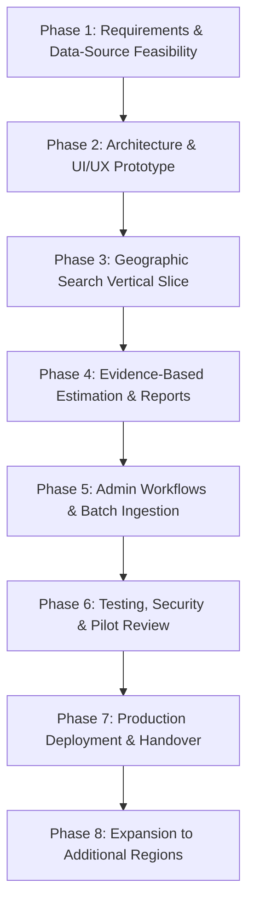

# Development Roadmap — Greenart Properties: Land Market Rate Analyst

This roadmap structures development into sequential, verifiable milestones. Progression between phases requires explicit stakeholder review and approval.

---

## Phase 1: Requirements & Data-Source Feasibility
- Formalize agreed R&D scope, commercial terms, and milestone payment schedules.
- Audit pilot data availability in initial Coimbatore target localities.
- Document legal access restrictions, terms of service, and update cadences for public and private data sources.
- Establish statistical rules and confidence thresholds with client sign-off.

---

## Phase 2: Architecture & UI/UX Prototype
- Initialize monorepo structure with `.NET 8` Clean Architecture backend, `React/Vite` admin portal, and `React Native/Expo` mobile client.
- Set up local PostgreSQL + PostGIS database schema and spatial EF Core context.
- Create UI/UX wireframes and component design system for both mobile and web applications.
- Establish shared TypeScript interfaces (`packages/shared-types`) and API contract specifications (`packages/contracts`).

---

## Phase 3: Initial Geographic-Search Vertical Slice
- Build end-to-end flow: target coordinate selection on map -> PostGIS `ST_DWithin` spatial query (1,000m radius) -> candidate record retrieval.
- Implement unit conversion and normalization engine (Sq.Ft, Cents, Acres, Grounds, Kuzhi to ₹/Sq.Ft and ₹/Cent).
- Return structured API response distinguishing between sufficient comparable evidence and explicit "Insufficient Data" notifications.
- Deliver working local demonstration on both Expo mobile app and React admin web app.

---

## Phase 4: Evidence-Based Estimation & Report Generation
- Implement approved statistical estimation engine (Median, Interquartile Range, outlier exclusion).
- Incorporate comparability filters (zoning, classification, observation freshness, verification tier).
- Develop customer valuation summary report (displaying sample size, date range, source composition, and legal disclaimer).
- Implement historical price trend visualization when sufficient longitudinal data is present.

---

## Phase 5: Admin Workflows & Batch Data Ingestion
- Build Admin authentication and Role-Based Access Control (RBAC).
- Implement Land Price Record CRUD with full audit logging and soft deletion.
- Build batch CSV/Excel import parser with strict row-by-row validation, duplicate detection, and rejected row error reporting.
- Implement verification workflow enabling data reviewers to promote unverified imports to verified status.

---

## Phase 6: Testing, Security & Pilot Review
- Comprehensive unit test coverage for estimation logic, spatial queries, and unit normalizations.
- API security hardening: rate limiting, strict CORS, input sanitization, error shielding.
- Penetration review and dependency vulnerability audits.
- Pilot dry-run using labelled Coimbatore datasets to evaluate estimate accuracy against local market knowledge.

---

## Phase 7: Production Deployment & Client Handover
- Execute domain registration (`greenart.group`) under client-owned corporate email and billing.
- Provision client-owned cloud resources (managed PostgreSQL/PostGIS, backend API hosting, CDN/static frontend hosting).
- Execute database migrations and seed baseline guideline values.
- Deliver operational documentation, backup/restore procedures, and source-code handover.

---

## Phase 8: Expansion to Additional Regions
- Expand data validation beyond Coimbatore to additional Tamil Nadu districts (Erode, Tiruppur, Salem, Chennai).
- Evaluate multi-state expansion criteria (accommodating regional land units, local revenue records, and state-specific classification systems).
- Architectural validation for global scalability.

